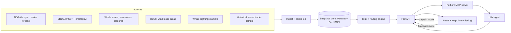

# Fathom — Design

> Put this file at `.kiro/specs/fathom/design.md`

## 1. Overview

Fathom has four parts:

1. **Data layer**: ingests and caches open ocean, zone, and sightings data into a common grid and GeoJSON format.
2. **Risk and routing engine**: deterministic, testable Python code (no LLM). It computes whale risk per cell, builds a cost grid, and finds routes.
3. **Agent layer**: an LLM with tool calling. It *orchestrates* the engine and *explains* results; it never invents numbers.
4. **Web app**: map-first UI with two modes: *Captain* (trip planner) and *Manager* (what-if simulator).

**Design principle:** the LLM never computes risk, routes, or zone facts. Tools do. The LLM plans, calls tools, and writes the explanation with citations. This is why the demo is trustworthy and why judges can't catch it hallucinating.

## 2. Architecture



**One MCP server, two users.** The data/risk/route tools are exposed as an **MCP server** (`fathom-mcp`). The in-app agent uses it at runtime, and **Kiro uses the same server during development** to query real data while writing code. That's a strong "how we used Kiro" story.

## 3. Data sources

> **Hour 0 task: run the data reality check.** Open the track starter zip and dataset links on the portal first; prefer anything provided there. Everything below is a *candidate*; confirm each endpoint works from your laptop and snapshot it immediately.

| Layer | Candidate source | Access | Fallback |
|---|---|---|---|
| Buoy obs (waves, wind, SST) | NOAA NDBC realtime text feeds | No key | Cached CSV |
| Marine forecast | NWS API (api.weather.gov) | No key | Cached JSON |
| SST / chlorophyll | NOAA ERDDAP (e.g., CoastWatch) | No key | Cached NetCDF subset |
| Right whale zones, slow zones | NOAA Fisheries geospatial downloads | Public | Hand-digitized polygons from published maps |
| Fishing closures / regulated areas | NOAA GARFO / Mass DMF public maps | Public | Hand-digitized |
| Offshore wind lease areas | BOEM open data | Public | Cached GeoJSON |
| Whale sightings | OBIS / public sightings datasets | Public | Synthetic seeded from published seasonal patterns |
| Vessel tracks | NOAA MarineCadastre historical AIS (one day, downsampled) | Public | Synthetic fleet seeded from port locations |
| Land mask | Natural Earth / NOAA shoreline | Public | Bundled |

If any source is missing, say so in the pitch and mark the layer "synthetic seed". Do not pretend.

## 4. Grid and data model

Study area: Massachusetts Bay, Cape Cod Bay, and the approaches (roughly 41°N–43.5°N, 71°W–69°W; adjust to your data).

```python
# core types (pydantic)
class Cell(BaseModel):
    id: str            # "ix_iy"
    lon: float
    lat: float
    is_land: bool

class Zone(BaseModel):
    id: str
    name: str
    kind: Literal["whale_sma", "slow_zone", "fishing_closure", "wind_lease", "wind_construction"]
    geometry: dict     # GeoJSON
    active_from: datetime | None
    active_to: datetime | None
    speed_limit_kn: float | None
    prohibited: bool   # no entry at all?
    source_url: str
    source_updated: datetime

class Sighting(BaseModel):
    lon: float; lat: float; observed_at: datetime; count: int; source: str

class Conditions(BaseModel):
    cell_id: str; time: datetime
    wave_m: float; wind_kn: float; sst_c: float | None
    source: str; fetched_at: datetime

class TripRequest(BaseModel):
    port: str
    vessel: Literal["small_boat", "mid_trawler", "scalloper"]
    cruise_kn: float; max_hours: float
    depart_window: tuple[datetime, datetime]
    target_ground: str | None
    risk_pref: float   # 0 = fastest, 1 = safest
    language: Literal["en", "pt", "es"]

class RoutePlan(BaseModel):
    waypoints: list[tuple[float, float]]
    eta_hours: float; fuel_est_l: float
    zones_crossed: list[str]
    max_wave_m: float
    risk_exposure: float        # sum(risk * hours)
    effort_proxy: float         # access to historical effort at destination
    citations: list[Citation]
```

## 5. Whale risk model

For cell `c`, time `t`, planned speed `v` (knots):

```
presence(c, month)  = kernel-smoothed historical sighting density, normalized 0..1
recency(c, t)       = 1 - Π over sightings s within radius R of (1 - exp(-age_days(s)/τ) * exp(-dist(s,c)/ρ))
p_whale(c, t)       = clip( α*presence + (1-α)*recency , 0, 1 )      # α ≈ 0.6, τ ≈ 7 days, ρ ≈ 10 km
lethality(v)        = 1 / (1 + exp(-(v - v50) / k))                  # v50 ≈ 11.8 kn, k ≈ 2.0
risk(c, t, v)       = p_whale(c, t) * lethality(v)
```

- The lethality curve is based on the published vessel-speed vs. lethal-injury relationship for large whales (Vanderlaan & Taggart, 2007). **Verify the exact parameters before putting numbers on a slide**, then cite the paper.
- Parameters live in `config/risk.yaml`, not in code, so they're explainable and tweakable in the demo.
- **Property tests** (see Tasks): risk is monotonic in speed; risk is 0 in land cells; adding a sighting never lowers risk; output always in [0, 1].

## 6. Routing

- **Graph:** 8-connected grid of water cells.
- **Edge cost:** `time_hours + λ_risk * risk(c,t,v_eff)*time_hours + λ_wx * weather_penalty(c,t)`
  - `v_eff = min(cruise_kn, zone.speed_limit_kn)` inside slow zones.
  - Cells inside `prohibited` active zones: infinite cost (impassable).
  - `weather_penalty` is 0 below a vessel-specific comfort wave height and rises steeply above it; above a hard limit, impassable.
- **Algorithm:** A* with a great-circle heuristic. Run with `λ_risk` derived from the user's `risk_pref`.
- **Time dependence:** step the grid in 3-hour slices; edge cost uses the slice at the estimated arrival time.
- **Outputs:** 3 alternates by sweeping `risk_pref` at 0.1, 0.5, 0.9 and de-duplicating similar routes.

Performance target: < 3 s per route on the study grid (precompute land mask and per-slice cost arrays with NumPy).

## 7. Agent design

- **Model:** Claude via Amazon Bedrock if the hackathon provides AWS credits; otherwise whichever model access you have.
- **Loop:** tool-calling agent with a max of 8 tool calls per request, streaming each call and result to the UI.
- **System prompt rules:** you are an advisory assistant; every factual claim must come from a tool result and be cited as `[tool:call_id]`; if no tool supports a claim, say you don't know; never state legal compliance.

### Tools (exposed via `fathom-mcp`)

| Tool | Input | Returns |
|---|---|---|
| `get_conditions` | bbox, time range | wave, wind, SST per cell + source + fetched_at |
| `get_zones` | bbox, time | zones active/inactive with metadata + source URLs |
| `get_whale_risk` | bbox, time, speed_kn | risk grid + top contributing factors per cell |
| `plan_routes` | TripRequest | 2–3 `RoutePlan` objects |
| `get_effort_proxy` | bbox, month | normalized historical effort grid |
| `estimate_fuel` | route, vessel | liters (clearly labeled estimate) |
| `simulate_zone` | candidate polygon, fleet sample id | Δrisk, Δtime, Δeffort access, per-vessel detail |
| `export_brief` | RoutePlan, language | one-page HTML/PDF path |

### Citation guard

Agent output is post-processed: any sentence containing a number, zone name, or date without a `[tool:...]` tag is flagged and either removed or re-prompted once. This is also a Kiro **agent hook** (see steering file).

## 8. What-if simulator

1. Load a **fleet sample**: ~200 vessel trips derived from historical tracks (or synthetic, seeded from port locations and known fishing grounds).
2. **Baseline:** route every trip with current zones → compute total `risk_exposure`, `steaming_hours`, `effort_access`.
3. **Scenario:** add candidate zone(s) → re-route every trip → recompute.
4. **Metrics:** `Δrisk%`, `Δhours%`, `Δfuel%`, `Δeffort_access%`.
5. **Compare options:** evaluate 3+ candidates (e.g., "extend SMA 20 nm east", "dynamic zone around latest sightings", "seasonal speed limit instead of closure"). Compute the **Pareto frontier**; highlight non-dominated options.
6. **Insight to show on stage:** often a *speed limit* or *dynamic zone* removes most of the risk at a fraction of the livelihood cost of a full closure. Show it only if your numbers support it; let the data speak.

Performance: route trips in parallel (multiprocessing); precompute cost grids; target < 20 s for 200 trips (show a progress bar; cache baseline).

## 9. API (FastAPI)

```
GET  /api/layers/conditions?bbox&time
GET  /api/layers/zones?bbox&time
GET  /api/layers/risk?bbox&time&speed
POST /api/trip/plan            -> streams agent events (SSE)
POST /api/trip/brief           -> brief file
POST /api/sim/run              -> scenario results
GET  /api/meta/sources         -> source list, timestamps, demo-mode flag
```

## 10. Frontend

- **Stack:** React + Vite + TypeScript, MapLibre GL, deck.gl (heatmap/hexagon layers), Tailwind.
- **Captain mode:** left chat/request panel, center map, bottom time slider, right plan cards with "why" expandable (tool calls + citations).
- **Manager mode:** map with draw tool, scenario list, trade-off chart (risk reduced vs. livelihood cost), plain-language summary.
- **Always visible:** data timestamp strip, "Demo data" badge when applicable, advisory disclaimer.
- **Design bar:** dark ocean theme, readable on a phone-sized viewport (captains use phones), large tap targets.

## 11. Error handling

| Failure | Behavior |
|---|---|
| Live source down | Use cached snapshot; badge layer "cached <timestamp>" |
| No legal route | Say so; list the binding constraint; suggest relaxing it |
| LLM error / timeout | Show the deterministic route results without narrative; retry once |
| Uncited claim | Strip or re-prompt once; log it |
| Draw tool gives invalid polygon | Show inline validation message |

## 12. Testing strategy

- **Property-based tests (Hypothesis):** risk monotonic in speed; risk ∈ [0,1]; land cells never routed; routes never enter prohibited active zones; adding a sighting never decreases risk.
- **Golden tests:** 3 fixed trip requests with expected route properties (avoids zone X, ETA within a range).
- **Agent evals:** 10 canned prompts; check every number is traceable to a tool result.
- **Demo-mode smoke test:** whole flow with network disabled.

## 13. Ethics and honesty

- Public/synthetic data only; label synthetic data on screen.
- Advisory only; no compliance guarantees.
- Effort proxy is not revenue; never present it as such.
- Whale sighting locations are public aggregates; do not expose any individual vessel's real identity in the demo.

## 14. Risks and mitigations

| Risk | Mitigation |
|---|---|
| A data source is hard to get | Hour-0 reality check; synthetic seed + clear label |
| Routing too slow | Precompute cost arrays; coarser grid in demo mode |
| Agent hallucinates | Tools-only facts + citation guard + "I don't know" rule |
| Scope creep | Core = Captain flow + one simulator scenario; everything else is stretch |
| Live demo fails | Demo mode with bundled snapshots + a recorded backup video |
